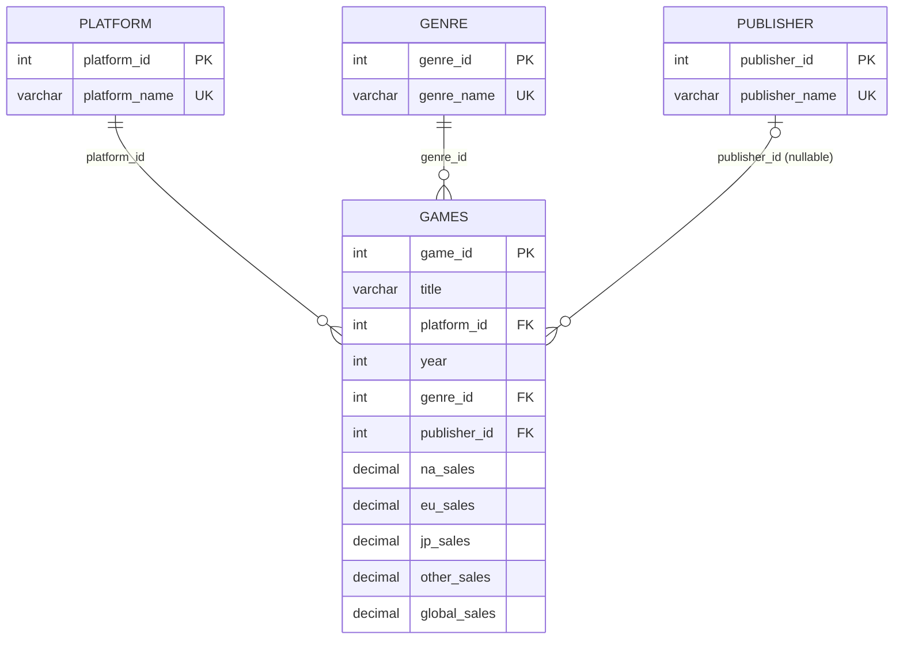

<div align="center">

# 🎮 Video Games DB: декомпозиция универсального отношения

**Пошаговая нормализация реляционной схемы на 16 598 записях о продажах видеоигр**
**с контролем ссылочной целостности и верифицируемой миграцией данных без потерь**


</div>

---

## 📖 Содержание

- [О проекте](#-о-проекте)
- [Постановка задачи](#-постановка-задачи)
- [Архитектура решения](#-архитектура-решения)
- [Метод декомпозиции](#-метод-декомпозиции)
- [Синхронизация связей](#-синхронизация-связей)
- [Функциональные зависимости](#-функциональные-зависимости)
- [Верификация и контроль целостности](#-верификация-и-контроль-целостности)
- [Идемпотентность и безопасность](#-идемпотентность-и-безопасность)
- [Быстрый старт](#-быстрый-старт)
- [Стек](#-стек)

---

## 🧭 О проекте

Проект представляет собой полный цикл **реинжиниринга реляционной схемы данных**: от анализа
денормализованного универсального отношения до получения набора нормализованных связанных
отношений с декларативно закреплённой ссылочной целостностью.

Исходный массив содержал **16 598 записей** о продажах видеоигр, где категориальные атрибуты
(платформа, жанр, издатель) хранились в виде повторяющихся текстовых значений. Такая организация
порождает **избыточность**, **аномалии обновления** и риск **семантического расхождения**
(разные написания одного и того же значения).

Решение устраняет эти недостатки методом **последовательной декомпозиции** с поэтапной
**синхронизацией связей** между вновь выделенными справочниками и основным отношением.

---

## 🎯 Постановка задачи

| № | Задача | Результат |
|---|--------|-----------|
| 1 | Выявить функциональные зависимости в универсальном отношении `games` | Зафиксированы зависимости для ключа и категориальных атрибутов |
| 2 | Выделить повторяющиеся атрибуты в самостоятельные сущности | Справочники `platform`, `genre`, `publisher` |
| 3 | Присвоить сущностям суррогатные первичные ключи | `AUTO_INCREMENT PRIMARY KEY` + `UNIQUE` на естественное значение |
| 4 | Мигрировать данные без потерь и дублирования | Массовое заполнение через `INSERT ... SELECT DISTINCT` |
| 5 | Синхронизировать связи и закрепить их на уровне СУБД | Внешние ключи (`FOREIGN KEY`) между `games` и справочниками |
| 6 | Доказать эквивалентность исходной и итоговой схем | Обратная сборка через `JOIN` и контрольные счётчики |

---

## 🏗 Архитектура решения



Категориальные атрибуты платформы, жанра и издателя взаимно независимы, поэтому справочники
образуют «звезду» вокруг основного отношения, а **вложенная (каскадная) декомпозиция не требуется**.

**До:** одно широкое отношение с текстовой избыточностью.
**После:** четыре связанных отношения, в основном отношении остались только числовые ключи
связей, год выпуска и показатели продаж.

---

## 🔬 Метод декомпозиции

Для каждого категориального атрибута применяется один и тот же формализованный цикл,
состоящий из трёх последовательных операций:

1. **Выделение сущности.** Уникальные значения атрибута извлекаются в отдельное отношение-справочник.
2. **Введение суррогатного ключа.** Справочнику добавляется первичный ключ, а естественному значению
   присваивается ограничение уникальности.
3. **Синхронизация связей.** Основное отношение перенастраивается на ссылку на справочник (см. ниже).

В результате на **10 шагов** приходятся: проверка ключа основного отношения, три цикла
«выделение → ключ → синхронизация» для платформы, жанра и издателя, а также итоговая сборка схемы.

```sql
-- Пример: выделение сущности «платформа» и введение суррогатного ключа
CREATE TABLE platform (platform_name VARCHAR(20) NOT NULL);

INSERT INTO platform (platform_name)
SELECT DISTINCT platform FROM games WHERE platform IS NOT NULL;

ALTER TABLE platform
  ADD COLUMN platform_id INT AUTO_INCREMENT PRIMARY KEY FIRST,
  ADD UNIQUE (platform_name);
```

---

## 🔗 Синхронизация связей

Наиболее ответственный этап: он гарантирует, что **ни одна запись не утрачена и не оказалась
«осиротевшей»**. Для каждого справочника выполняется строго упорядоченная четырёхшаговая процедура:

| Шаг | Операция | Назначение |
|-----|----------|------------|
| 1 | `ALTER TABLE ... ADD COLUMN *_id` | Подготовка столбца под внешний ключ |
| 2 | `UPDATE ... JOIN` по естественному значению | Заполнение ключей на основе справочника |
| 3 | Контрольный `COUNT(*)` по `IS NULL` | Доказательство полноты сопоставления |
| 4 | `DROP COLUMN` + `ADD CONSTRAINT FOREIGN KEY` | Устранение избыточности и декларативное закрепление связи |

```sql
-- Синхронизация связи games → platform
ALTER TABLE games ADD COLUMN platform_id INT;

UPDATE games g
JOIN platform p ON g.platform = p.platform_name
SET g.platform_id = p.platform_id;

SELECT COUNT(*) AS no_platform FROM games WHERE platform_id IS NULL;  -- ожидается 0

ALTER TABLE games DROP COLUMN platform;
ALTER TABLE games
  ADD CONSTRAINT fk_games_platform
  FOREIGN KEY (platform_id) REFERENCES platform (platform_id);
```

> **Обработка неполных данных.** У 58 записей издатель в источнике отсутствует (`NULL`).
> Такие записи **сохраняются в основном отношении** с пустой ссылкой `publisher_id`:
> внешний ключ допускает `NULL`, поэтому данные не искажаются и не удаляются, а при обратной
> сборке используется `LEFT JOIN`.

---

## 📐 Функциональные зависимости

```text
{platform_id}  →  {platform_name}
{genre_id}     →  {genre_name}
{publisher_id} →  {publisher_name}
{game_id}      →  {title, platform_id, year, genre_id, publisher_id,
                   na_sales, eu_sales, jp_sales, other_sales, global_sales}
```

Транзитивные зависимости категориальных атрибутов от первичного ключа устранены:
каждый неключевой атрибут справочников зависит только от своего ключа.

> ℹ️ Поле `global_sales` является суммой региональных продаж. Оно сознательно оставлено в
> основном отношении как вычисляемая величина для удобства аналитических запросов.

---

## ✅ Верификация и контроль целостности

Эквивалентность исходной и итоговой схем подтверждается **обратной сборкой** универсального
отношения и сверкой числа записей:

```sql
SELECT g.game_id, g.title, p.platform_name, ge.genre_name, pb.publisher_name
FROM games g
JOIN platform  p  ON g.platform_id  = p.platform_id
JOIN genre     ge ON g.genre_id     = ge.genre_id
LEFT JOIN publisher pb ON g.publisher_id = pb.publisher_id;

SELECT (SELECT COUNT(*) FROM games_backup) AS before_cnt,
       (SELECT COUNT(*) FROM games)        AS after_cnt;   -- 16598 = 16598
```

| Проверка | Ожидаемое значение |
|----------|--------------------|
| Записей без платформы | `0` |
| Записей без жанра | `0` |
| Записей без издателя | `58` (отсутствуют в источнике) |
| Число записей до / после | `16 598 / 16 598` |

---

## 🛡 Идемпотентность и безопасность

- **Резервное копирование.** Перед преобразованием создаётся копия `games_backup`
  (`CREATE TABLE ... LIKE` + `INSERT ... SELECT`), что позволяет выполнить откат.
- **Изолированная демонстрация.** Повторяемый сценарий работает на копии с префиксом `demo_`
  и не затрагивает рабочие таблицы.
- **Воспроизводимость.** Сценарий начинается с `DROP TABLE IF EXISTS` и может быть выполнен
  многократно с одинаковым результатом.
- **Порядок удаления.** Таблицы удаляются с учётом внешних ключей: сначала основное отношение,
  затем справочники.

---

## 🚀 Быстрый старт

```bash
# 1. Клонировать репозиторий
git clone <url-вашего-репозитория>
cd <папка-репозитория>

# 2. Убедиться, что исходная таблица games_backup существует в схеме video_games

# 3. Выполнить сценарий декомпозиции
mysql -u <user> -p video_games < decomposition.sql
```

Либо открыть `decomposition.sql` в клиенте (DBeaver, MySQL Shell for VS Code) и выполнять
блоки по шагам, сверяя контрольные счётчики.

---

## 🧰 Стек

| Компонент | Назначение |
|-----------|-----------|
| **MySQL 8** | СУБД |
| **SQL (DDL/DML)** | Проектирование схемы, миграция данных |
| **DBeaver / MySQL Shell for VS Code** | Разработка и отладка запросов |
| **Mermaid** | ER-диаграмма в документации |

---

<div align="center">

*Нормализация, ссылочная целостность и воспроизводимая миграция данных на практике.*

</div>
